  

> **`[NPC] IHEB:`** *Data Science & AI Engineering student and AI software engineer. I build AI-powered apps and full-stack systems: RAG / LLM pipelines, applied machine learning and solid backends. Hand me a messy problem, I'll respawn it as a shipped product.* 🕹️

<table>
<tr><td align="center"><b>🧠 SPELLBOOK</b> AI / LLM</td><td>

</td></tr>
<tr><td align="center"><b>⚔️ WEAPONS</b> Backend</td><td>

</td></tr>
<tr><td align="center"><b>🛡️ ARMOR</b> Frontend & Mobile</td><td>

</td></tr>
<tr><td align="center"><b>🔮 POTIONS</b> Data & ML</td><td>

</td></tr>
<tr><td align="center"><b>🚀 MOUNTS</b> DevOps</td><td>

</td></tr>
</table>

<table>
<tr>
<td width="50%"></td>
<td width="50%"></td>
</tr>
<tr>
<td width="50%"></td>
<td width="50%"></td>
</tr>
<tr>
<td width="50%"></td>
<td width="50%"></td>
</tr>
</table>

<picture>
  <source media="(prefers-color-scheme: dark)" srcset="https://raw.githubusercontent.com/iheblam/iheblam/output/github-snake-dark.svg"/>
  <source media="(prefers-color-scheme: light)" srcset="https://raw.githubusercontent.com/iheblam/iheblam/output/github-snake.svg"/>
  
</picture>

