<div align="center">


<a href="https://linkedin.com/in/iheb-lamouchi"></a>
<a href="mailto:iheblamouchi.ik@gmail.com"></a>
<a href="https://iheblam.github.io"></a>


<br/><br/>




</div>

```python
>>> iheb.describe()
"Data Science & AI Engineering student and AI software engineer. I build AI-powered apps and
 full-stack systems: RAG / LLM pipelines, applied machine learning and solid backends.
 Give me raw, messy data and I'll ship it as a working product."
```

<div align="center">


<table>
<tr><td align="center"><b>🧠 MODEL LAYER</b><br/><sub>AI / LLM</sub></td><td>


</td></tr>
<tr><td align="center"><b>🗄️ DATA LAYER</b><br/><sub>Data & ML</sub></td><td>


</td></tr>
<tr><td align="center"><b>⚙️ SERVING LAYER</b><br/><sub>Backend</sub></td><td>


</td></tr>
<tr><td align="center"><b>🖥️ PRESENTATION</b><br/><sub>Frontend & Mobile</sub></td><td>

</td></tr>
<tr><td align="center"><b>🚀 ORCHESTRATION</b><br/><sub>DevOps</sub></td><td>


</td></tr>
</table>


<table>
<tr>
<td width="50%"><a href="https://github.com/iheblam/CrisisVision"></a></td>
<td width="50%"><a href="https://github.com/iheblam/HomeDoc_Frontend"></a></td>
</tr>
<tr>
<td width="50%"><a href="https://github.com/iheblam/techcare-pro"></a></td>
<td width="50%"><a href="https://github.com/iheblam/sportwear-ecommerce-frontend"></a></td>
</tr>
<tr>
<td width="50%"><a href="https://github.com/iheblam/social-feed-backend"></a></td>
<td width="50%"><a href="https://github.com/iheblam/Esport-project-front-Part"></a></td>
</tr>
</table>





<picture>
  <source media="(prefers-color-scheme: dark)" srcset="https://raw.githubusercontent.com/iheblam/iheblam/output/github-snake-dark.svg"/>
  <source media="(prefers-color-scheme: light)" srcset="https://raw.githubusercontent.com/iheblam/iheblam/output/github-snake.svg"/>
  
</picture>




<a href="https://linkedin.com/in/iheb-lamouchi"></a>
<a href="mailto:iheblamouchi.ik@gmail.com"></a>
<a href="https://github.com/iheblam"></a>

</div>
